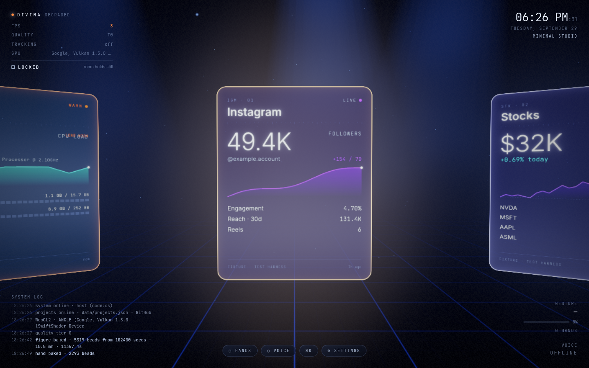

# Divina

A spatial operating system in a browser tab. Ten holographic modules orbit the viewer; hands (MediaPipe) are the primary input, the mouse is the fallback. **Divina**, the voice inside it, streams from Gemini, controls the Mac or Windows PC it is served from through a guarded bridge, and can take a human form: one particle buffer, one clock.



## Run

```bash
npm install          # also copies the MediaPipe wasm and fetches the hand model into public/
cp .env.example .env.local   # everything is optional
npm run dev          # http://localhost:3000
```

| Var | What it unlocks |
| --- | --- |
| `GEMINI_API_KEY` | Streaming model + studio voice. Without it (or another AI key) DIVINA runs the local command engine and the browser voice. |
| `ANTHROPIC_API_KEY`, `OPENAI_API_KEY`, `ELEVENLABS_API_KEY` | Other AIs (Claude, OpenAI) and voices (OpenAI, ElevenLabs). Pick which in Settings (`DIVINA_AI_PROVIDER`, `DIVINA_TTS_PROVIDER`). Keys saved in Settings are stored encrypted. |
| `DIVINA_DESKTOP_BRIDGE=1` | Desktop control on macOS or Windows (off by default; 501 on other platforms). |
| `DIVINA_CITY` / `DIVINA_LAT` `DIVINA_LON` | Weather when browser location is not granted. |
| `DIVINA_CALENDAR_ICS` | Calendar (secret iCal URL), or put a file at `data/calendar.ics`. |
| `INSTAGRAM_TOKEN` (+ `IG_BUSINESS_ACCOUNT_ID` for `EAA…`) | Instagram telemetry. |
| `DIVINA_LEAGUE` | Sports: one or more ESPN codes, comma-separated (`soccer/eng.1, soccer/esp.1, basketball/nba`, up to 6). |

Stocks read `data/portfolio.json` (falls back to `data/portfolio.example.json`, labelled *example holdings* on the card). Projects read `data/projects.json`. A module with no source says it is **not connected** and tells you what to set. No module shows made-up numbers.

## Safety, privacy and licences

- [SECURITY.md](SECURITY.md): local-only server, other websites refused, keys never leave the server, spending caps, the AI can't act on your computer by itself.
- [PRIVACY.md](PRIVACY.md): exactly what leaves your computer, and to whom.
- [THIRD_PARTY_NOTICES.md](THIRD_PARTY_NOTICES.md): licences of everything Divina uses, and which free data sources must be replaced or licensed before selling Divina.
- [LICENSE](LICENSE): free software under the GNU Affero General Public License v3 (or later). You can use, study, change and share Divina; if you run a modified version as a network service, you must offer its users your source. The Divina name and logos are not covered — a fork uses its own. You bring your own AI key (Gemini, Claude or OpenAI) and pay that company directly for what you use.

## Settings (no files to edit)

Click **⚙ settings** at the bottom of the screen, press ⌘K / Ctrl+K and type "settings", or say "Divina, open settings". Everything applies immediately:

- **Voice & replies:** natural (Google) or fast (browser) voice, which natural voice, reply speed (fast/deep thinking), captions or hologram, caption size, and what may interrupt Divina (her name / "stop" by default, any speech, or never).
- **AI:** API key (write-only: the page only sees `…last4`), model.
- **Sports:** tick up to six leagues, or say "Divina, follow the NBA" / "stop following the NFL" / "only follow the NFL, the Scottish Premiership and the NBA".
- **Weather & news:** city, topic. **Accounts:** calendar iCal address, Instagram, GitHub.

Values are saved in `data/settings.local.json` (or `%APPDATA%\Divina` when installed) on this machine (git-ignored) and win over `.env.local`. The Settings API uses the same loopback + same-origin + custom-header checks as the desktop bridge. Desktop control is deliberately the one switch the page cannot turn on.

## Fast start

Double-click **Divina.cmd** (Windows) or run `npm run launch`. It installs on first run, rebuilds only after an update, starts the fast production server and opens the browser. `npm run dev` is still there for development, but it recompiles as you use it and feels slower.

## Browser edition (free)

```bash
npm run build:web   # → out/ and dist/divina-web-<version>.zip, served from /app/
DIVINA_BASE_PATH= npm run build:web   # served from the root of your own site instead
```

A static site with no server: put it on any static host. The same code as the app, built with `DIVINA_EDITION=web`:

- `src/web/backend.ts` answers the page's own `/api/*` calls in the browser. Settings, the visitor's own Gemini key and their calendar file are kept in their `localStorage`; weather (MET Norway), news (Hacker News via Algolia) and Gemini are called directly. Gemini, the chat turn and the settings rules are shared with the server (`src/lib/ai/`, `src/lib/settingsSchema.ts`).
- Included: the room, hands, voice, ⌘K, the human form, weather, news, calendar (.ics upload), system, the AI with the visitor's own key. Stocks, sports, Instagram, projects and desktop control say they come with the Windows app.
- API routes and middleware are `.ts` files and the web build only picks up `.tsx` pages, so no server code is in the bundle. Headers (CSP, no framing) are written to `out/_headers`, the format most static hosts read; the policy is shared with the app via `csp.mjs`.

See [ROADMAP.md](ROADMAP.md) for what's left before a public launch.

## New-tab extension (Chrome and Edge)

```bash
npm run build:extension   # → build/extension (load unpacked) and dist/divina-extension-<version>.zip (for the stores)
```

The browser edition as every new tab, built with `DIVINA_PLATFORM=extension`. It's calmer than the website: a search box front and centre (it uses the browser's own search engine through `chrome.search`, so Divina never picks or changes it), the clock and the dock, with no diagnostics or system log, a four-times-faster opening, and the camera never switching on by itself. Only the cards that work without the Windows app are on the ring. Weather uses the city typed in Settings, because asking for location access would add a warning at install.

The build makes the export fit the extension rules: Next.js's inline scripts move into one file, `_next` becomes `next` (names starting with `_` are reserved), and the security policy moves into `manifest.json`. The only permission is `search`. To try it, open `chrome://extensions` or `edge://extensions`, turn on Developer mode, choose **Load unpacked** and pick `build/extension`.

## Windows installer

```bash
npm run build:windows   # needs NSIS: apt install nsis
```

| File | Size | Node.js |
| --- | --- | --- |
| `dist/Divina-Setup-<version>.exe` | ~34 MB | inside; installs offline |
| `dist/Divina-Setup-<version>-web.exe` | ~13 MB | downloaded from nodejs.org during setup (curl, or PowerShell as a fallback), SHA-256 checked against the value baked in at build time, skipped when that version is already installed |

Both are 64-bit NSIS installers built from a Next.js standalone server (TypeScript, sharp and the unused MediaPipe variants are left out). The build refuses to finish if a `.env*`, `settings.local.json`, `portfolio.json`, `calendar.ics` or any saved key from this machine would end up inside.

What the person gets:

- a per-user install in `%LOCALAPPDATA%\Programs\Divina` (no admin prompt), Start menu and desktop shortcuts, an entry in *Add or remove programs*
- **Divina.exe** (no console): starts the server on `127.0.0.1:47800` (next free port up to 47805) and opens Edge, or Chrome, as an app window with its own profile, so camera and mic permissions are remembered. Closing the window stops the server. Opening it again while it runs just opens a window.
- settings and keys in `%APPDATA%\Divina` (entered from ⚙ Settings), so updates never wipe them; the uninstaller asks before deleting them. Server log: `%APPDATA%\Divina\divina.log`.
- desktop control is on (`DIVINA_DESKTOP_BRIDGE=1`); the AI still asks before acting by itself.

Releases are built by GitHub Actions (`.github/workflows/release.yml`) when a `v*` tag is pushed, and attached to the GitHub release with their SHA-256 checksums; `Divina-Setup.exe` is always the latest. The installer is not code-signed yet, so Windows SmartScreen shows "Windows protected your PC" on first run (More info → Run anyway).

## Controls

| | Hands | Mouse / keys | Voice |
| --- | --- | --- | --- |
| Rotate | swipe left / right | drag, wheel, ← → | "rotate left" |
| Open / expand | pull toward the camera | click, Enter | "open stocks" |
| Collapse | push away | click empty, Esc | "close" |
| Grab / drop | pinch / release (returns to its slot on a spring) | hold on a card | — |
| Freeze ring | hold an open palm still | F | — |
| Wake DIVINA | draw a circle with a finger | Space | "Divina …" |
| Zoom / split / group | two-hand pinch spread · two open hands apart / together | — | — |
| Multi-select | hold a pinch, tap-pinch with the other hand | — | — |
| Motion | — | M, or the LOCKED/DRIFT control | "hold still" / "start drifting" |
| Worlds | — | 1–6 | "switch to the fog chamber" |
| Human form | — | ⌘K → Transform | "Divina, transform into a human shape" / "return to spatial mode" |

⌘K lists apps (live scan, when the bridge is on), websites, modules, worlds and commands in one ranked list with source tags, and is reachable with the HUD hidden (H).

## Architecture

```
src/
  core/        master clock (timeline + envelopes), motion vocabulary, springs, intent bus
  stores/      zustand: ring, world, system, gesture, ai, embodiment, data, toasts
  gesture/     MediaPipe tracker · per-frame classifier (pure) · temporal recognizer (pure) · engine → intents
  interaction/ controller (intents → state) · mouse/keyboard fallback
  render/      scene, camera rig, atmosphere (fog volume, dust, beams, floor), cards (glass shader,
               face canvases, bracket), worlds (6 worlds + grades, weather, market floor), post (DoF,
               bloom, colour grade), holo text
  embodiment/  SDFs (bust + data-authored hand), GPU bake, Poisson selection, capture, journey
               buffer, bead impostors, head/jaw rig, hand rig
  ai/          command engine (pure) · assistant (stream, tools, barge-in) · speech in · voice out
  audio/       synth pad, UI sounds, HRTF voice bus + analyser, ducking
  modules/     ids/meta, data contracts, card faces, detail panels, summaries, warnings, feeds
  hud/ launcher/  DOM layer
  lib/server/  providers (MET Norway, Yahoo Finance, HN Algolia, ESPN, iCal, Instagram Graph,
               GitHub, node:os), Gemini proxy, desktop bridge
```

Input sources never import renderers; everything publishes intents on `core/bus` and the controller owns state changes. Per-frame values live in mutable objects (`render/live.ts`, `handCursor`), so React never renders at 60 Hz.

### One clock
`core/clock/masterClock.ts` is advanced once per frame before any reader. It owns the ambient-motion gate (a 0..1 multiplier that settles in ~1 s), the module presentation (targeting → approach → settle, asymmetric), the embodiment timeline (`NORMAL → COMMAND_DETECTED → COLLAPSING → PARTICLE_CORE → SKELETON_FORMING → HUMANOID_FORMING → HUMANOID_ACTIVE`, with `RETURNING` being the same curve run backward at 1.7×) and one-shot pulses (wake wave, world cut, selection). Layers read envelopes and write nothing back.

### Phase 7 in one paragraph
At the command every card face canvas (the same canvases the cards sample) is rasterised and sampled: text → hot fragments, saturated glyphs/charts → accent streams, the pane → dim glass; dust, light and HUD corners contribute the rest. Each particle stores its card index + face uv, so the vertex shader places it with that card's world matrix every frame (ten matrices per frame); it leaves when `t > cardStart + edgeFactor(uv)·span` — the exact expression the card fragment shader uses to erode, so face and particle agree pixel for pixel. Particles are paired with figure points by order (first to leave → crown). The figure is an SDF bust baked once on the GPU (Newton steps in a fragment shader, 16-bit packed RGBA8 readback over two frames) and thinned to an exact count by weighted sample elimination (blue noise), then drawn as opaque sphere impostors writing curved depth. The hand is a second SDF generated from a finger data table that also emits the GLSL hinge code; one curl uniform cups and opens it.

## Desktop bridge (macOS and Windows)

`src/lib/server/desktop/` — treated as the remote-code-execution surface it is:

1. `execFile`/`spawn` with `shell:false` only (`exec.ts`); AppleScript is always a constant, data arrives as `item n of argv`.
2. Verbs are a closed enum; `IMPLEMENTATIONS: { [V in Verb]: Impl<V> }` makes a new verb a type error until it has args and an implementation.
3. Apps resolve against a live scan of `/Applications` & co. — unknown names cannot be launched.
4. Loopback `Host` only (403). 5. Same-origin `Origin` + `Sec-Fetch-Site` + a custom header that forces a CORS preflight the server never grants. 6. Off unless `DIVINA_DESKTOP_BRIDGE=1`; anything but macOS/Windows → 501.

No shutdown, restart, delete or force-quit. Quit is a polite AppleScript `quit` so apps can ask about unsaved work. Permission failures are translated into the exact setting for the terminal that runs the server (`permissions.ts`: Screen Recording, Automation −1743, Accessibility). Links open with Chrome's `--new-window` (window ids are diffed to find ours) or Safari's `make new document`, placed on the second display using NSScreen → Carbon coordinate conversion, and announced by the display's real name ("on your LG ULTRAWIDE"). Do Not Disturb has no public API; the bridge runs two Shortcuts you create ("Divina Focus On/Off") and says so if they are missing.

**Injection demo:** `npm test` includes `injected command strings resolve to "no such application" and never execute` — eight payloads (`Safari; rm -rf ~`, `$(rm -rf /)`, backticks, pipes, AppleScript breakout…) go through the real `launch_app` verb with a spy runner; every one returns 404 *No such application* and the runner is never called.

### Windows

Run it like any Node app — PowerShell or Windows Terminal, Chrome or Edge (voice needs Chromium):

```powershell
npm install
copy .env.example .env.local     # set DIVINA_DESKTOP_BRIDGE=1 to enable desktop control
npm run dev                      # http://localhost:3000   (⌘K is Ctrl+K)
```

`src/lib/server/desktop/windows.ts` implements the same verb table with the same rules. Programs start via `execFile`/`spawn` with argv arrays (no `cmd.exe`, no `start`). PowerShell only runs constant scripts from that file, sent with `-EncodedCommand`; caller data reaches them only as `DIVINA_*` environment variables, which are read as strings and never evaluated. Apps resolve against a live `Get-StartApps` scan (Start-menu shortcuts as fallback) and launch through `explorer.exe shell:AppsFolder\<AppID>`; quitting resolves against running windowed processes and uses `CloseMainWindow` (like clicking ✕), never `Stop-Process`.

| Verb | Windows |
| --- | --- |
| launch / quit app | Start-menu scan → explorer · CloseMainWindow |
| open website | Chrome or Edge `--new-window`, new window found by diffing window handles, moved to the second display (`SetWindowPos`), named from the monitor's EDID ("on your LG ULTRAWIDE") |
| media | media keys (play/pause is one toggle on Windows) · now playing from the system media session (Spotify, browsers, Media Player) |
| volume | Core Audio default output: exact level, ±, mute |
| screenshot · clipboard | System.Drawing capture of the whole virtual screen · Get/Set-Clipboard |
| hide others · lock · sleep display | minimise other windows · LockWorkStation · monitor power-off |
| Do Not Disturb · notes · reminders | refused with an explanation (no public Windows API) |

Failures are translated too: Constrained Language Mode / AppLocker, Group-Policy execution policy, elevation boundaries ("start Windows Terminal as administrator"), a busy clipboard, capture while locked. `tests/windows.test.ts` runs the Windows table on any OS with a spy runner, including the injection payloads. **It has not yet been run on a real Windows machine** — please report anything that misbehaves.

## Verification

```bash
npm test          # 28 unit tests: bridge guard + injection (macOS and Windows tables), ranking, iCal, Instagram, timeline, springs, commands
npm run build
npm run verify    # needs a running server; drives the real app in headless Chromium
```

`npm run verify` (results in `docs/verify-report.json`, screenshots in `docs/screens/`):

| Check | Result |
| --- | --- |
| Ring angle / camera position / camera rotation drift over 5 s, zero input, motion locked | **0 / 0 / 0** exactly |
| Centred card | gold = 1, warn = 0 |
| Centred card forced into warning (portfolio −4.2 %) | **gold = 0**, warn = 1 |
| Figure rig over 4 s, zero input | 0 of 40 samples changed |
| Mouth in silence / with the local voice / after | 0 / steps {0, .25, .5, .75}, jaw ≤ 0.12 rad / 0 |
| Presented panel after settling | moved **0 px** over 3 s |
| Rotate while embodied (hand + voice) | refused (front step unchanged) |
| Return | `RETURNING` → `NORMAL` |

Journey frames: [collapsing](docs/screens/verify-emb-collapsing.png) · [core](docs/screens/verify-emb-core.png) · [skeleton](docs/screens/verify-emb-skeleton.png) · [forming](docs/screens/verify-emb-forming.png) · [active](docs/screens/verify-emb-active.png) · [hand presenting](docs/screens/verify-hand.png) · [panel settled](docs/screens/verify-panel-settled.png) · [return](docs/screens/verify-return.png).

The harness substitutes `tests/fixtures/modules.json` for upstream data at the network layer (their provenance reads *FIXTURE · TEST HARNESS*); the app itself ships no fake data.

## Stack notes

Next.js 15 · React 19 · TypeScript · Tailwind v4 · React Three Fiber 9 · three.js · postprocessing · Framer Motion · Zustand · MediaPipe Tasks Vision. Rapier was retired by Phase 6 (cards are never handed to a physics simulation — springs only). GSAP, React Spring, Drei, Valtio and Lenis ended up with nothing to do (named curves + one spring integrator cover every motion, and there is no page scroll), so they are not dependencies.
